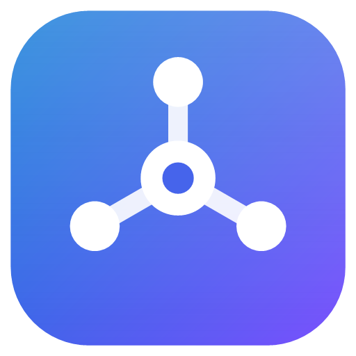

# MCP Client

A small desktop app for trying out MCP servers, over Streamable HTTP or stdio, for **Windows**, **macOS** and **Linux**.
Built on the official [ModelContextProtocol](https://github.com/modelcontextprotocol/csharp-sdk) C# SDK.

- **Windows**: a Windows Forms app with a Windows 11 look (`src/McpClientUI`).
- **macOS** and **Linux**: the same features in an Avalonia app (`src/McpClientUI.Avalonia`).
- Both are thin UIs over `src/McpClientUI.Core`: connecting, listing, calling, argument fields from the
  JSON schema, history, saved values and encrypted headers.

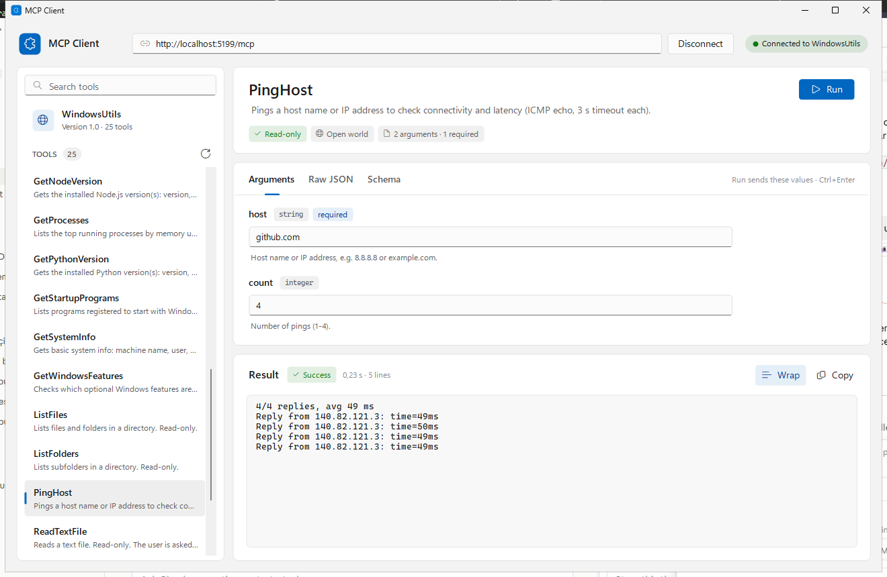

```powershell
dotnet run --project src/McpClientUI                  # Windows app; follows the Windows light/dark setting
dotnet run --project src/McpClientUI -- --theme dark
dotnet run --project src/McpClientUI.Avalonia         # cross-platform app (macOS, Linux, Windows)
```

- Enter the server URL (default `http://localhost:5199/mcp`) and press **Connect**. The last URL and recent URLs are remembered.
- For a **stdio** server, type the command that starts it instead of a URL, for example
  `npx -y @modelcontextprotocol/server-everything`, `uvx mcp-server-time` or `C:\Tools\my-server.exe --flag`.
  The app starts the process, talks to it over stdin/stdout and stops it on Disconnect. If it fails to start,
  the last lines it wrote to stderr are shown. **Environment** (in place of Headers) sets variables such as API keys
  for that process, stored encrypted like the headers.
- **Headers** sets a Bearer token and any other HTTP headers (API keys, ...) for that URL. They are stored encrypted
  for your account: DPAPI on Windows, AES-GCM with a key only you can read on macOS and Linux. Settings and history
  live in `%AppData%\McpClientUI` (Windows) or `~/Library/Application Support/McpClientUI` (macOS).
- The sidebar has four tabs, all searchable:
  - **Tools**: pick one to see its description, hints (read-only, open world, ...) and a form built from its input schema:
    text and number boxes, true/false switches, JSON boxes for objects and arrays, defaults filled in, required fields checked.
  - **Resources**: plain resources are read with **Read**; resource templates such as `users/{id}` get a form for their variables.
  - **Prompts**: fill in the prompt's arguments and press **Get** to see its messages.
  - **History**: every call with its arguments, status, time and result, kept between runs. Click one to bring back its
    arguments and result, double-click to run it again.
- Click the server entry for its version, protocol and instructions.
- **Raw JSON** sends hand-written arguments instead of the form; **Schema** shows the input schema.
- **Saved** stores the current argument values under a name (per server and tool) and loads them back later.
- **Run** calls the tool; the result shows its status and time, JSON results are colored. Calls can be cancelled.

Shortcuts: `Ctrl+Enter` (`⌘↩` on a Mac) run, `Enter` in a field run, `Esc` cancel, `Ctrl+F` / `⌘F` search, `F5` reload from the server.

## macOS

Download `McpClientUI-<version>-osx-arm64.zip` (Apple Silicon) or `-osx-x64.zip` (Intel) from the
[releases](https://github.com/anilkay/MCPClientUI/releases), unzip it and move **MCP Client.app** to Applications.

Releases are signed with a Developer ID and notarized by Apple when the signing secrets below are set; such a copy
opens with a double click. Without them the app is signed ad hoc, and macOS blocks the first launch of a downloaded
copy: allow it once in **System Settings › Privacy & Security › Open Anyway**, or run

```bash
xattr -dr com.apple.quarantine "/Applications/MCP Client.app"
```

### Signing and notarization (maintainers)

Add these repository secrets (Settings › Secrets and variables › Actions); `release.yml` then signs the Mac app with
the hardened runtime (`src/McpClientUI.Avalonia/macOS/entitlements.plist`), notarizes it with `notarytool` and staples it:

| Secret | What |
| --- | --- |
| `MACOS_CERTIFICATE_P12` | Your **Developer ID Application** certificate with its private key, exported from Keychain Access as .p12, in base64 (`base64 -i cert.p12 \| pbcopy`) |
| `MACOS_CERTIFICATE_PASSWORD` | The .p12 password |
| `APPLE_TEAM_ID` | Your team id (developer.apple.com › Membership) |
| `NOTARY_KEY_P8` | An App Store Connect API key (Users and Access › Integrations), the .p8 file in base64 |
| `NOTARY_KEY_ID`, `NOTARY_ISSUER_ID` | That key's Key ID and Issuer ID |

Stdio servers started from the app find tools installed with Homebrew, npm or pip (`npx`, `uvx`, `node`, `python`):
the app adds `/opt/homebrew/bin`, `/usr/local/bin` and `~/.local/bin` to the PATH, which a Finder launch doesn't have.

## Linux

Download `McpClientUI-<version>-x86_64.AppImage` from the [releases](https://github.com/anilkay/MCPClientUI/releases),
make it executable and run it:

```bash
chmod +x McpClientUI-*-x86_64.AppImage
./McpClientUI-*-x86_64.AppImage
```

If your distribution has no FUSE 2 (`libfuse2`), start it with `APPIMAGE_EXTRACT_AND_RUN=1`, or use
`McpClientUI-<version>-linux-x64.tar.gz` instead: unpack it and run `McpClientUI/McpClientUI.Avalonia`.
Settings, history and the encrypted headers are kept in `~/.config/McpClientUI`.

## Screenshots of the Avalonia app

| Avalonia app (dark) | Prompts |
| --- | --- |
| 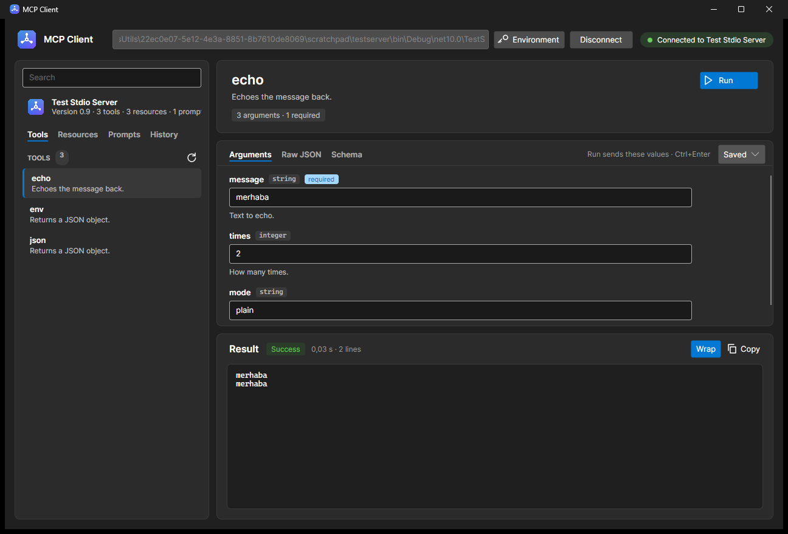 | 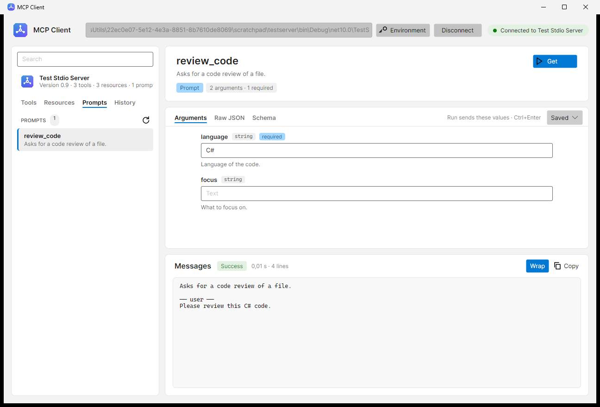 |

## Screenshots

| Dark theme | Server overview |
| --- | --- |
| 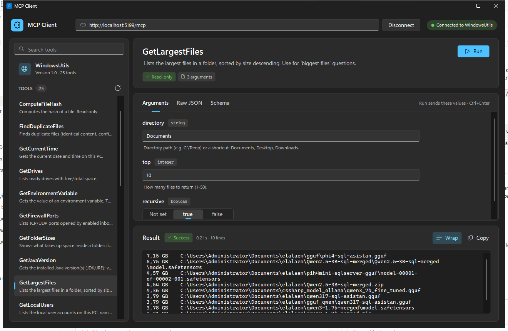 | 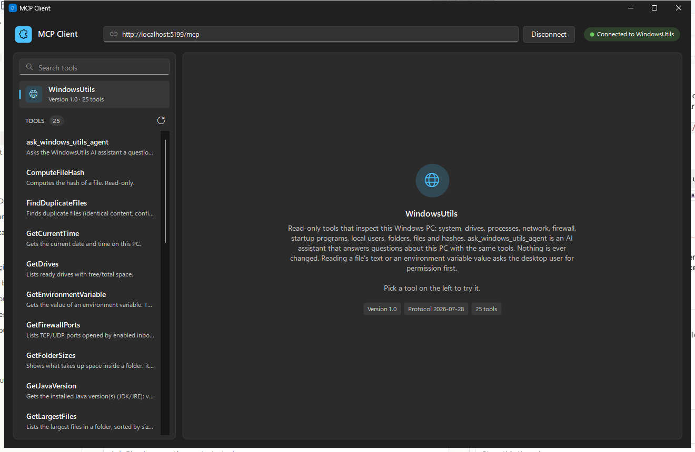 |

| Prompts | Resource templates |
| --- | --- |
| 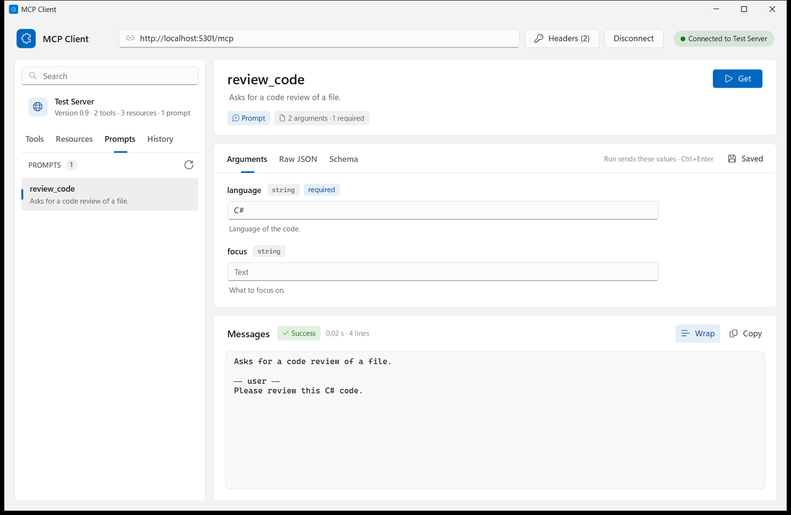 | 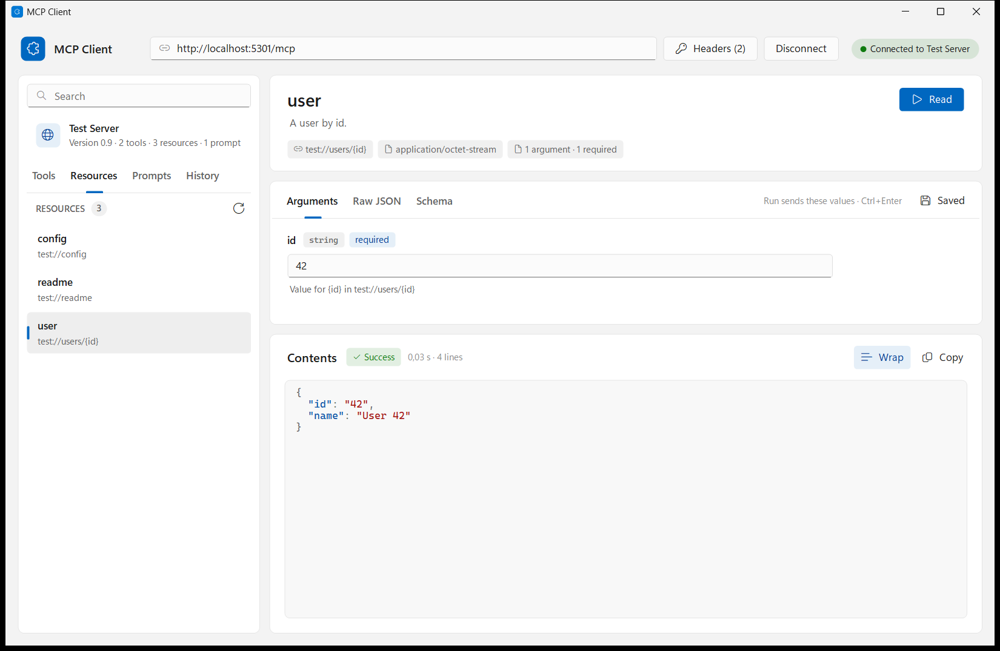 |

| History | Request headers |
| --- | --- |
| 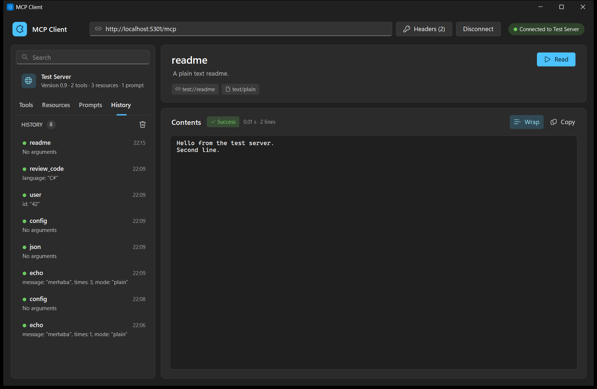 | 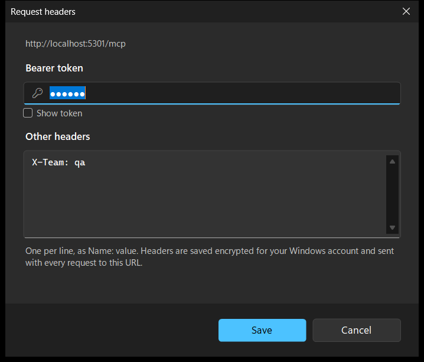 |

When the server can't be reached, the reason is shown in place:

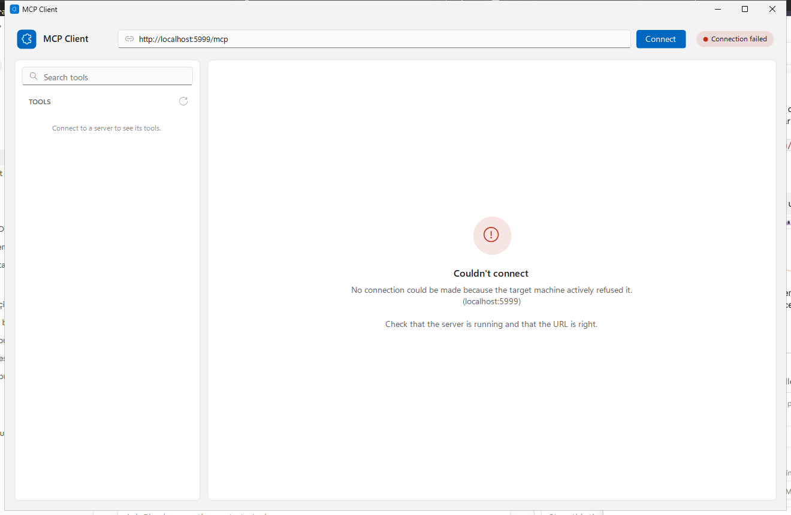

## Requirements

- To build: the .NET 10 SDK (Windows for the WinForms app; any OS for the Avalonia app).
- An MCP server: Streamable HTTP (for example the one WindowsUtils starts from its AI Chat screen) or stdio.

## Releases

Every push to `main` is built by `.github/workflows/build.yml`. To publish a release, run

```powershell
.\release.ps1 0.1.0
```

It pushes a `v0.1.0` tag; `.github/workflows/release.yml` then attaches to the
[GitHub release](https://github.com/anilkay/MCPClientUI/releases):

- `McpClientUI-<tag>-win-x64.zip`: the Windows app, a self-contained single-file `McpClientUI.exe` (no .NET install needed, ~47 MB).
- `McpClientUI-<tag>-osx-arm64.zip` and `-osx-x64.zip`: **MCP Client.app** for Apple Silicon and Intel Macs,
  packaged by `src/McpClientUI.Avalonia/macOS/package-app.sh`.
- `McpClientUI-<tag>-x86_64.AppImage` and `-linux-x64.tar.gz`: the Linux app, packaged by
  `src/McpClientUI.Avalonia/linux/package-appimage.sh`.

The build workflow also packages the Mac app and the AppImage on every push and starts them on macOS
and Linux runners; the `McpClientUI-osx-arm64-app` and `McpClientUI-linux-appimage` artifacts let you
try a build before releasing it.

## Build options

| Build | Size | Needs | Command |
| --- | --- | --- | --- |
| Self-contained single file (what releases ship) | ~47 MB exe | nothing | `dotnet publish src/McpClientUI/McpClientUI.csproj -c Release -r win-x64 --self-contained true -p:PublishSingleFile=true -p:IncludeNativeLibrariesForSelfExtract=true -p:EnableCompressionInSingleFile=true -p:DebugType=none -o publish` |
| Framework-dependent single file | ~2.4 MB exe (~0.8 MB zipped) | [.NET 10 Desktop Runtime](https://dotnet.microsoft.com/download/dotnet/10.0) | `dotnet publish src/McpClientUI/McpClientUI.csproj -c Release -r win-x64 --self-contained false -p:PublishSingleFile=true -p:DebugType=none -o publish` |

The self-contained build can't get much smaller: Windows Forms doesn't support trimming, and the
single file is already compressed.
